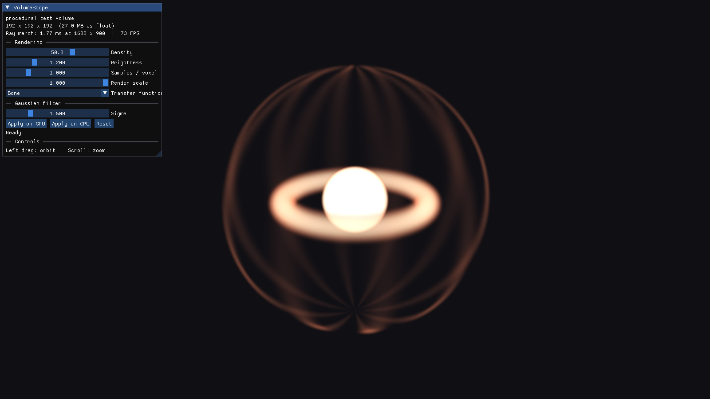
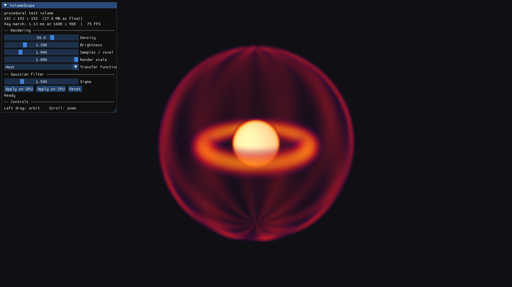
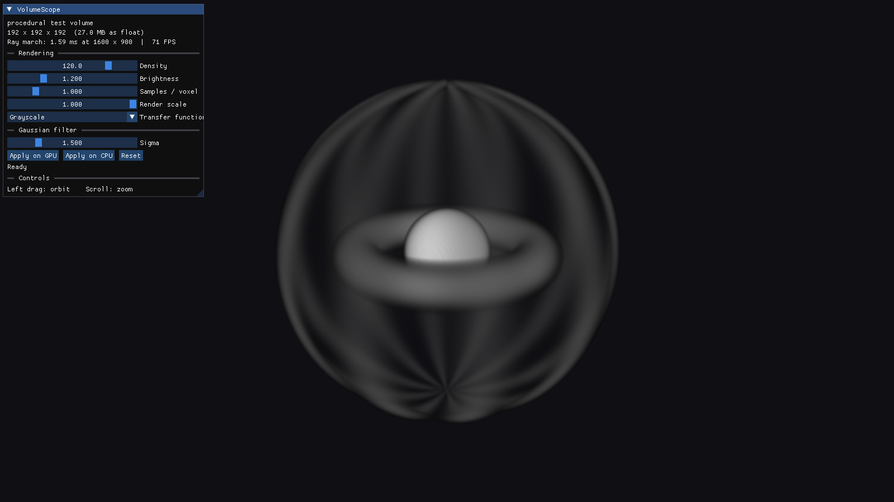

# VolumeScope

A desktop viewer for large 3D scan data (CT, MRI, ultrasound, simulations), written in modern C++20 and CUDA.
It loads a scalar volume, processes it on the GPU, and renders it interactively with CUDA ray marching.

> Status: stage 1 scaffold. See the roadmap below.



| Heat transfer function | Grayscale, higher density | After a GPU Gaussian blur (σ = 3) |
|---|---|---|
|  |  |  |

All screenshots are generated by the app itself, on an RTX 5070 Ti at 1600×900:

```
volumescope --preset 1 --screenshot docs/images/viewer-bone.png
volumescope --preset 2 --screenshot docs/images/viewer-heat.png
volumescope --preset 0 --density 120 --screenshot docs/images/viewer-grayscale.png
volumescope --preset 1 --blur 3 --screenshot docs/images/viewer-gpu-blur.png
```

## Features

- **CUDA volume ray marching**: front-to-back compositing, opacity correction, early ray termination,
  hardware trilinear sampling through a 3D texture object.
- **Transfer functions**: control points baked into a 1D lookup texture (Grayscale, Bone, Heat presets).
- **GPU image processing**: separable 3D Gaussian blur in CUDA, validated against a CPU reference.
- **Raw volume loader**: Open SciVis naming convention, `uint8` / `uint16` / `float32`, normalized to [0, 1].
- **Desktop UI**: GLFW + Dear ImGui, orbit camera, live render settings and timings, PNG screenshots.
- **Tests and CI**: GoogleTest for CPU code and GPU code (GPU tests skip when no device), GitHub Actions on Linux.

## Building

Requirements: CMake 3.28+, CUDA Toolkit 12.x or 13.x, a C++20 compiler (MSVC 2022/2026 or GCC 13+), an NVIDIA GPU.
GLFW, Dear ImGui and GoogleTest are fetched automatically.

**Windows (Visual Studio 2026):**

```
cmake --preset windows-vs
cmake --build --preset windows-release
ctest --preset windows-release
build\windows-vs\Release\volumescope.exe data\bonsai_256x256x256_uint8.raw
```

**Linux:**

```
cmake --preset linux-release
cmake --build --preset linux-release
ctest --preset linux-release
./build/linux-release/volumescope data/bonsai_256x256x256_uint8.raw
```

Without a file argument the viewer opens a procedural test volume. See [data/README.md](data/README.md) for datasets.

Command-line options: `--preset N` (0 Grayscale, 1 Bone, 2 Heat), `--density D`, `--blur SIGMA` (GPU Gaussian at
startup), `--screenshot out.png` (render a few frames, save the window as PNG, exit).

## Architecture

```
src/
  core/   CPU only: Volume, raw loader, transfer functions, reference filters, procedural data
  gpu/    CUDA: RAII device buffers and textures, ray marcher, filters
  app/    GLFW + ImGui viewer
tests/    GoogleTest (CPU tests + GPU tests labelled "gpu")
```

Design choices:

- **RAII for every GPU resource** (`DeviceBuffer<T>`, `VolumeTexture`, `TransferTexture`, `GpuTimer`): move-only,
  no leaks on exceptions, CUDA errors become `vs::gpu::CudaError` exceptions.
- **CPU reference implementations** for every GPU algorithm, so correctness is tested, not assumed.
- **`core` has no CUDA dependency**, so loaders and algorithms can be reused by a headless tool.

## Benchmarks

| Operation | Volume | CPU | GPU | Speed-up |
|---|---|---|---|---|
| Gaussian blur, sigma 1.5 | 256³ | _todo_ | _todo_ | _todo_ |
| Ray march, 1600×900 | 256³ | n/a | _todo_ | n/a |

Measure on your own machine and fill these in. Note the GPU model, and compare against a multithreaded
CPU baseline before quoting a speed-up.

## Roadmap

**Stage 1: core viewer**
- [x] Raw loader, CUDA ray marcher, transfer function presets, ImGui viewer
- [ ] CUDA-OpenGL interop instead of copying each frame through the host
- [ ] Gradient-based shading (central differences in the ray marcher)
- [ ] Editable transfer function in the UI

**Stage 2: image processing**
- [ ] Shared-memory tiled convolution and a benchmark against the naive kernel
- [ ] Median filter, threshold and segmentation, Sobel edge detection
- [ ] Multithreaded CPU baselines and a benchmark tool (`volumescope_bench`)

**Stage 3: large data**
- [ ] Memory-mapped loading
- [ ] Brick the volume, stream visible bricks into an LRU cache on the GPU with async CUDA streams and pinned memory
- [ ] Level of detail; render a volume larger than GPU memory

**Stage 4: polish**
- [ ] Axial / sagittal / coronal slice views
- [ ] Headless processing CLI + Dockerfile
- [ ] Windows CI job
